# Active Directory Configuration

This document covers the AD DS deployment, the DNS and DHCP services that support it, and the first Group Policy and OU setup.

## Overview

| Item | Value |
|---|---|
| Forest / domain | `lab.local` |
| Deployment type | New forest (single domain controller) |
| Domain controller | `WIN-J6BC254EIMC` |
| NetBIOS domain | `LAB` |
| Domain controller IP | `192.168.64.4` |

## Promoting the server to a domain controller

After installing the **Active Directory Domain Services** role, I ran the AD DS Configuration Wizard from the Server Manager notification flag.

On the **Deployment Configuration** page I chose **Add a new forest** and entered the root domain name `lab.local`.

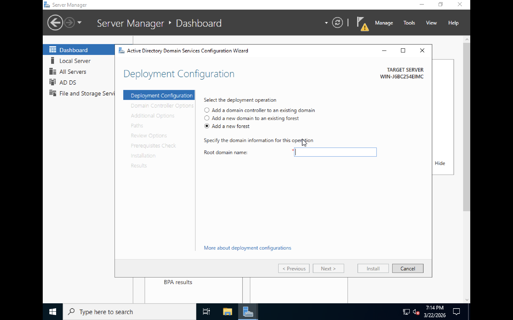

> **TODO:** note the forest/domain functional level, that DNS server was selected on the Domain Controller Options page, and that a DSRM password was set. These pages were not captured.

The wizard then ran the prerequisites check and installed, and the server restarted as a domain controller.

## Verifying the deployment

- **Server Manager > Local Server** shows the domain as `lab.local`.
- The **Tools** menu now lists the AD tools: Active Directory Users and Computers, Domains and Trusts, Sites and Services, Administrative Center, ADSI Edit and Group Policy Management.

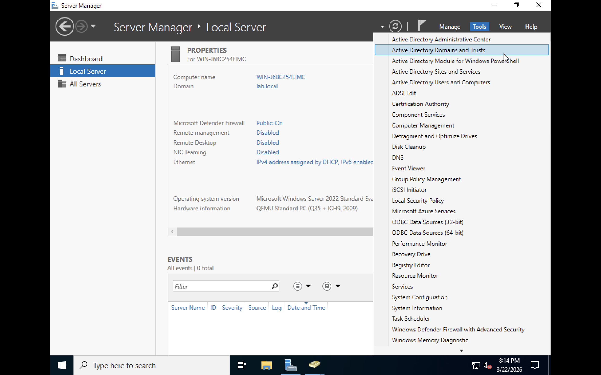

- **DNS Manager** opens and shows the server:

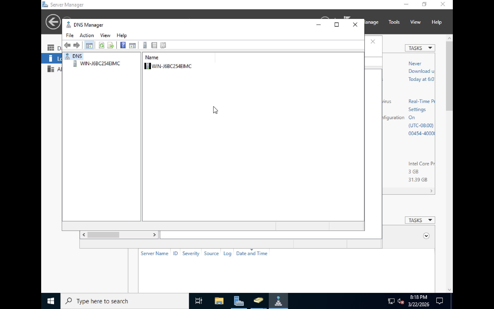

- `ipconfig /all` reports `lab.local` as the primary DNS suffix, and the server uses itself (`::1` and `127.0.0.1`) as its DNS server, which is expected for a DC that hosts DNS.

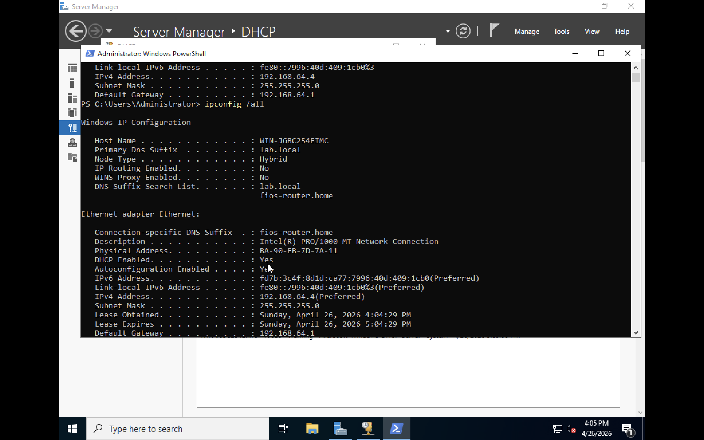

## DHCP

I added the **DHCP Server** role and then created scopes from the DHCP console. Server Manager gets a DHCP page once the role is installed.

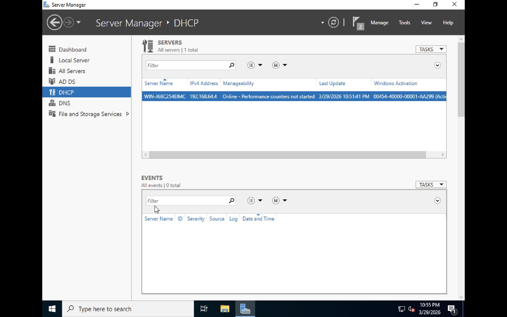

### First scope (3/30/2026)

| Setting | Value |
|---|---|
| Name | `LabScope` |
| Range | `192.168.1.100` to `192.168.1.200` |
| Mask | `255.255.255.0` (/24) |

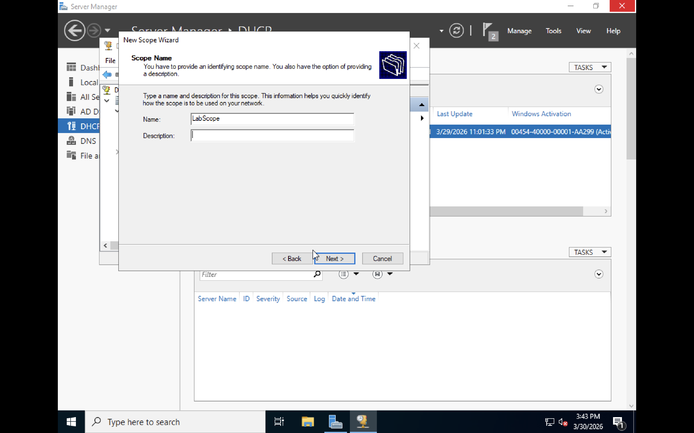
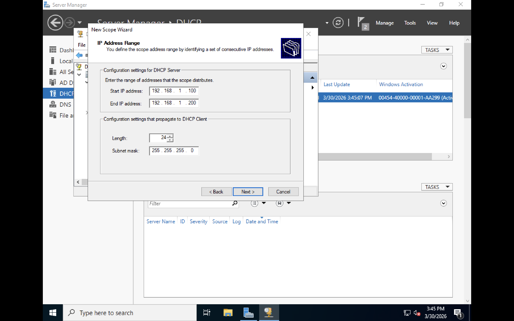

### Second scope (4/26/2026)

| Setting | Value |
|---|---|
| Range | `10.0.2.100` to `10.0.2.200` |
| Mask | `255.255.255.0` |
| Router (default gateway) | `10.0.2.2` |

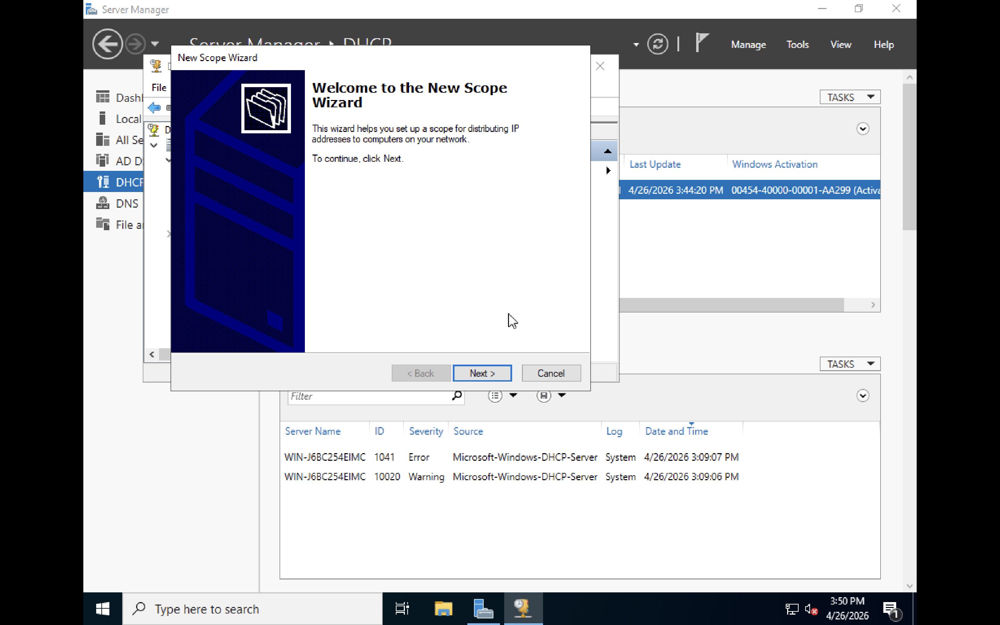

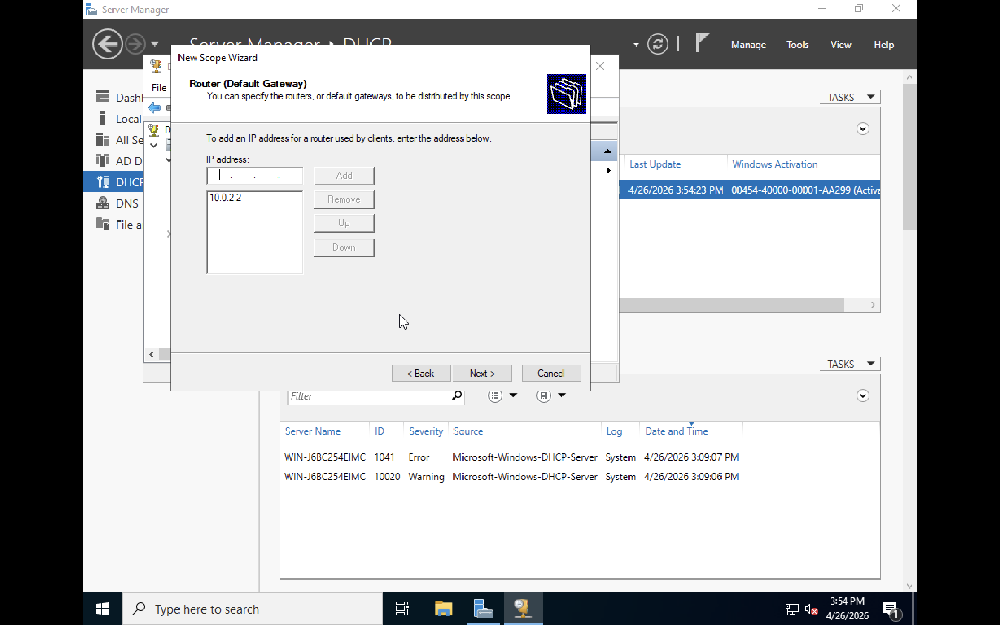

> **TODO:** confirm whether the scope was activated and whether the DHCP server was authorized in AD. See [troubleshooting.md](troubleshooting.md) for the issues I hit with DHCP.

## Organizational Unit and Group Policy

I created an OU named **CallCenter** at the domain root, with *Protect container from accidental deletion* left checked.

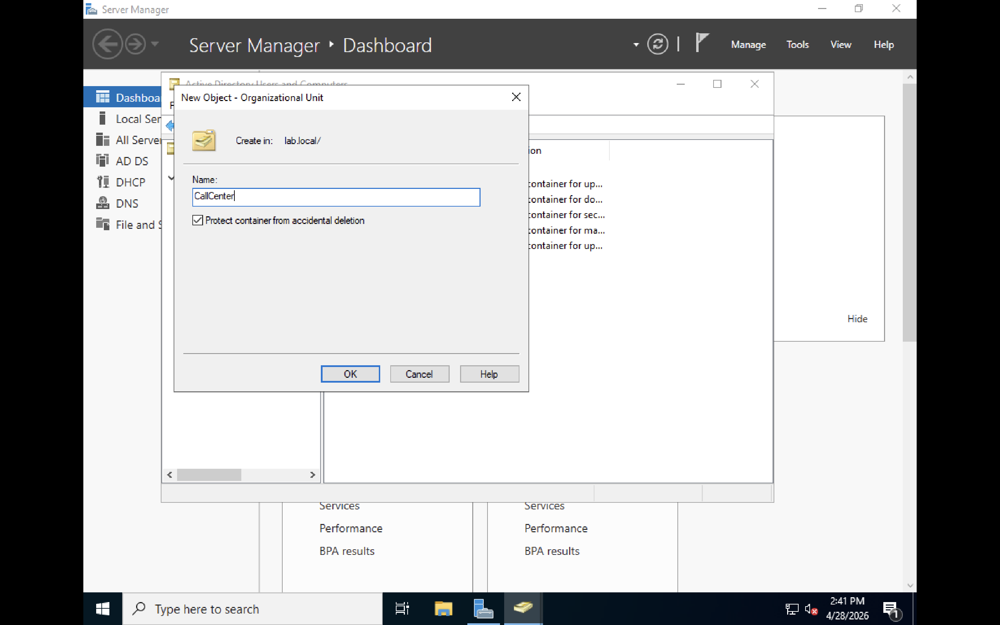

In **Group Policy Management** I created a new GPO and linked it to the CallCenter OU. The link is enabled, not enforced, and the GPO status is Enabled.

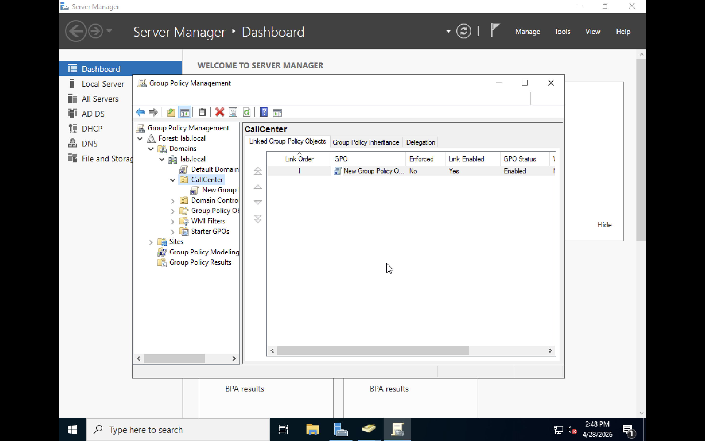

> **TODO:** list the settings configured in the GPO, if any.

User accounts in this OU are covered in [user-management.md](user-management.md).
