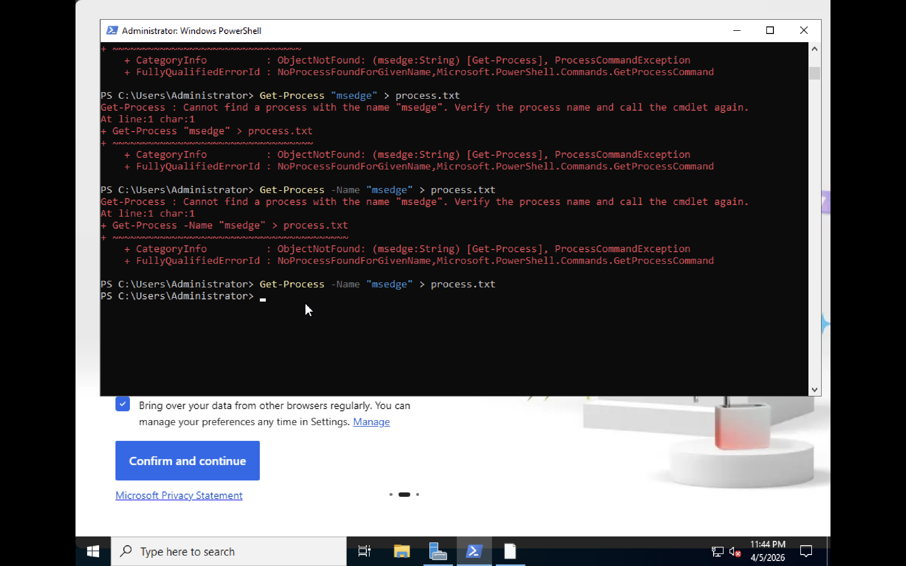
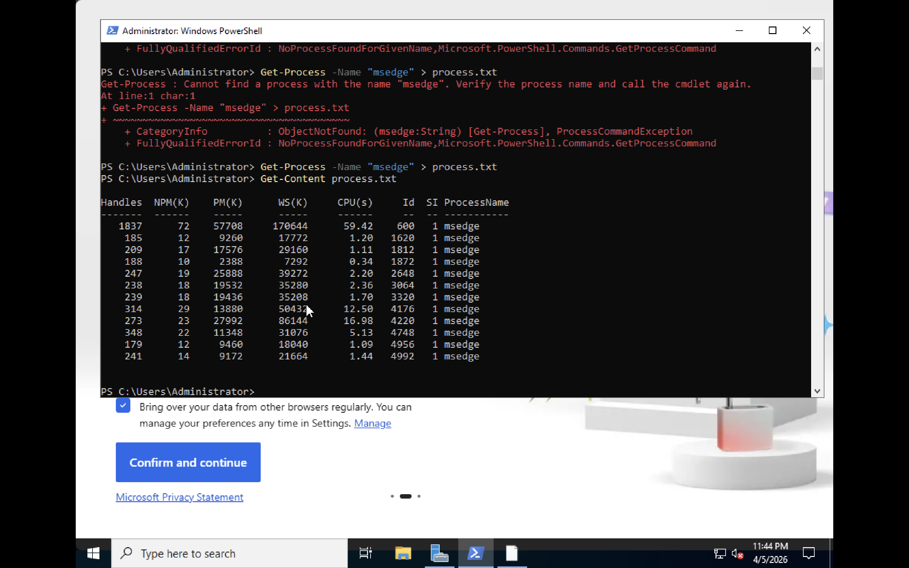
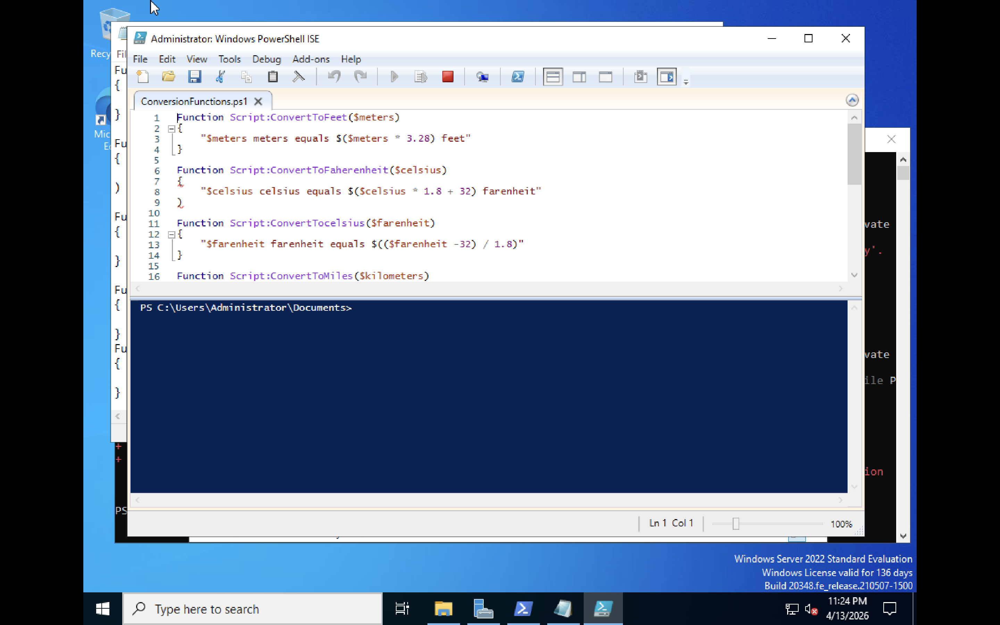
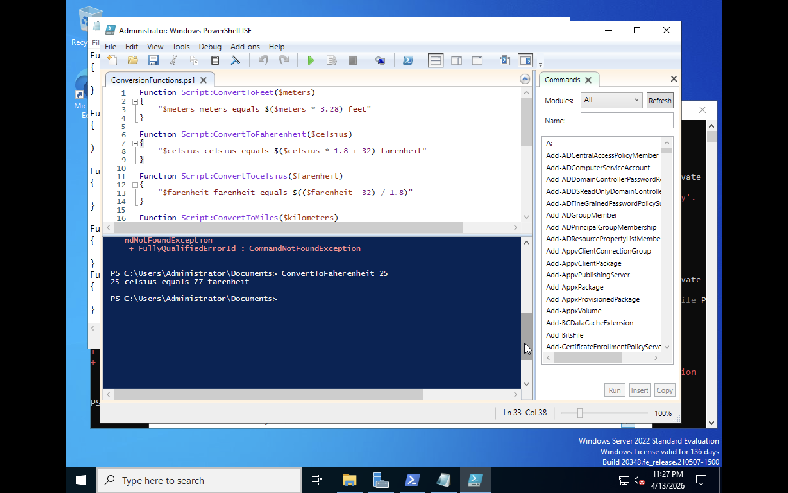
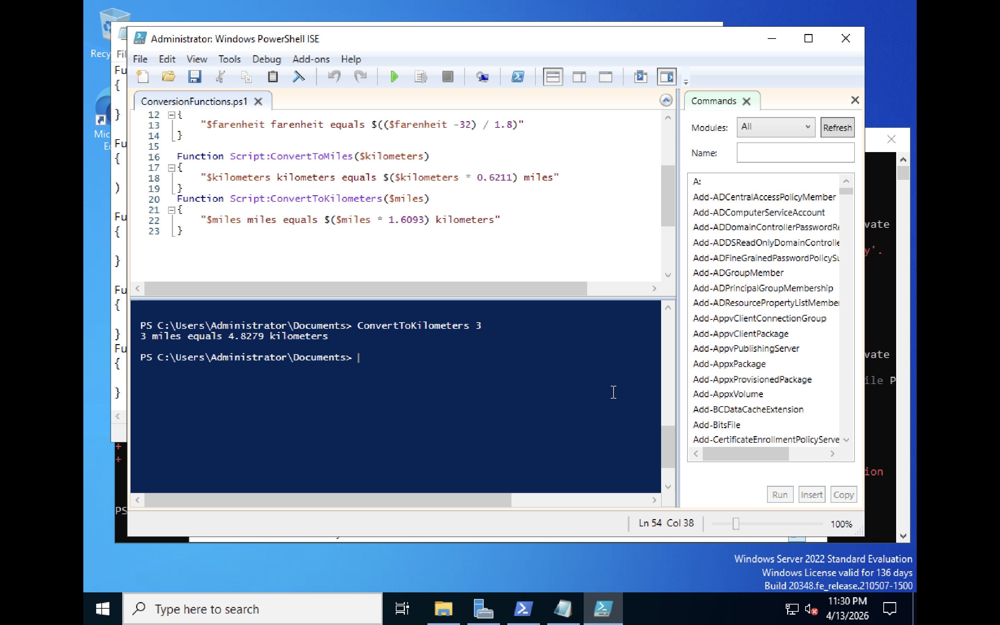
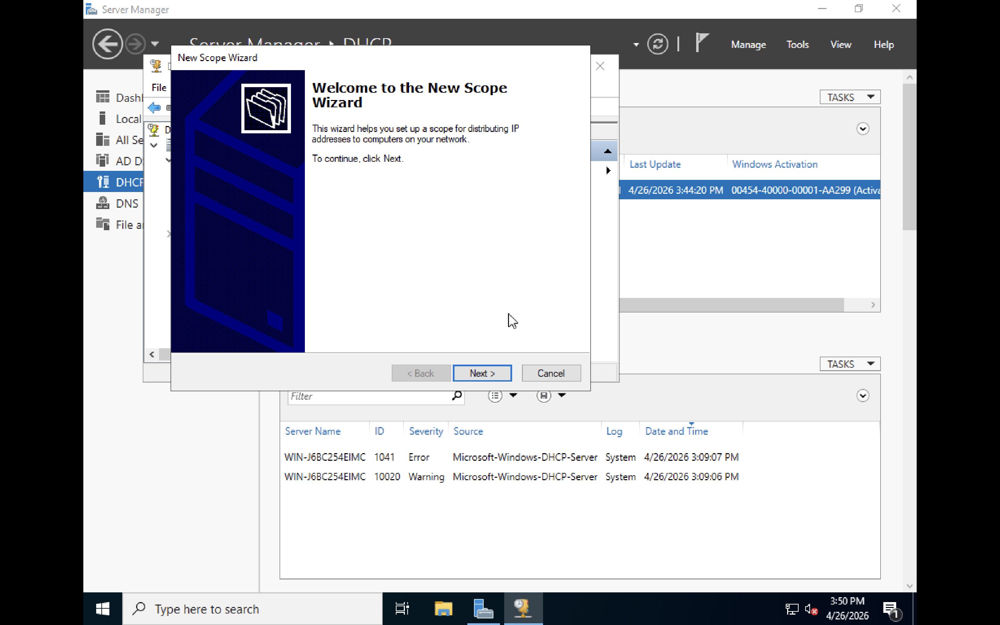
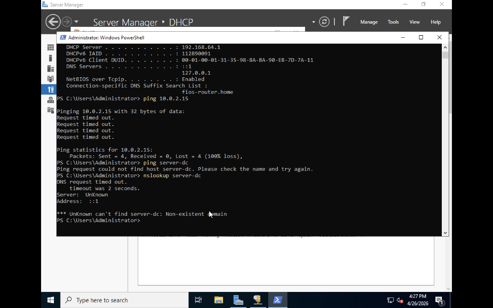
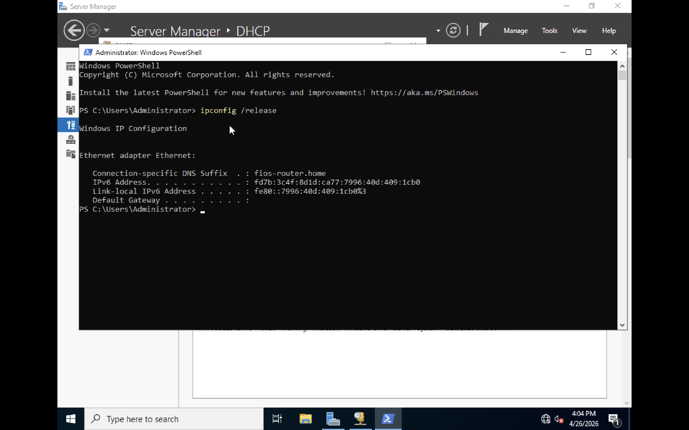
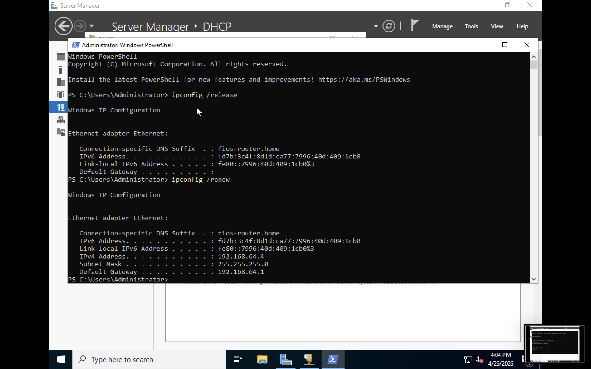
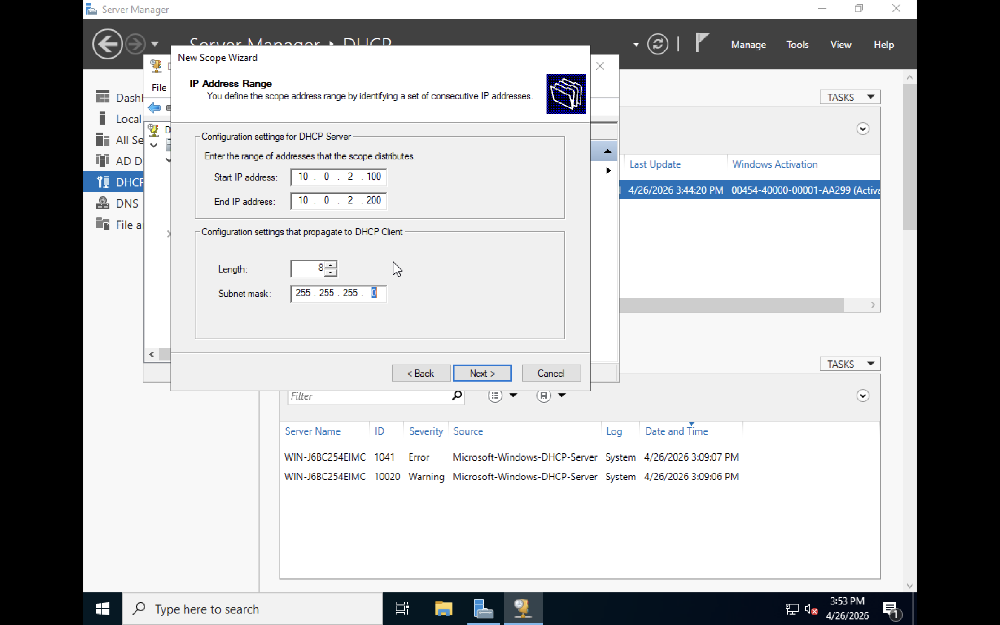

# Troubleshooting

Problems I ran into during the lab, what the evidence showed, and how each was handled.

> **TODO:** where a fix is marked unconfirmed, replace it with what you actually did.

## 1. `Get-Process` could not find `msedge`

**Symptom:** Running `Get-Process "msedge" > process.txt` and `Get-Process -Name "msedge" > process.txt` returned `Cannot find a process with the name "msedge"` (`NoProcessFoundForGivenName`).

**Cause:** Microsoft Edge was not running. `Get-Process` only lists running processes. The syntax was fine.

**Fix:** I launched Edge (its first-run setup page is visible behind the console) and ran the same command again. It completed without errors, and `Get-Content process.txt` showed the Edge processes.

**Takeaway:** Check that the target process is running before troubleshooting the command.

## 2. Custom functions not recognized in PowerShell ISE

**Symptom:** Calling my conversion functions returned `CommandNotFoundException`.

**Cause (likely):** The functions in `ConversionFunctions.ps1` are defined with the `Script:` scope, so they are only available after the script has been run in the session.

**Fix:** Run the script first (the console shows the full path to `ConversionFunctions.ps1` being executed), then call the functions. Function names must also match exactly as defined, including the spelling used in the script (`ConvertToFaherenheit`, `ConvertTocelsius`).

| Command | Result |
|---|---|
| `ConvertToFeet 10` | 10 meters equals 32.8 feet |
| `ConvertToFaherenheit 25` | 25 celsius equals 77 farenheit |
| `ConvertTocelsius 77` | 77 farenheit equals 25 |
| `ConvertToMiles 5` | 5 kilometers equals 3.1055 miles |
| `ConvertToKilometers 3` | 3 miles equals 4.8279 kilometers |

## 3. DHCP server errors in the event log

**Symptom:** Server Manager's DHCP page showed two events from `Microsoft-Windows-DHCP-Server` at 3:09 PM on 4/26/2026: **Event 1041 (Error)** and **Event 10020 (Warning)**.

**Likely cause:** Event 1041 is logged when the DHCP service finds no network interface with a statically configured IPv4 address. This server's only adapter gets its address from the hypervisor's DHCP (`192.168.64.4`), not a static one.

**Resolution:** *Unconfirmed.* The usual fix is to give the adapter a static IPv4 address in the scope's subnet, then restart the DHCP service.

> **TODO:** document the actual fix, and open Event Viewer to read the full text of event 10020.

## 4. DHCP scope subnet does not match the server's network

**Symptom:** I created a scope for `10.0.2.100` to `10.0.2.200`, but the server's adapter is on `192.168.64.0/24`. Test commands against that range failed:

- `ping 10.0.2.15` returned 100% loss (4 of 4 timed out)

I also saw that `ipconfig /release` followed by `/renew` gave the server `192.168.64.4` from DHCP server `192.168.64.1`. That is the hypervisor's DHCP, not the scope I built on the lab server.

**Cause:** The scope range, the router (`10.0.2.2`) and the VM's virtual network are on different subnets, and the hypervisor's DHCP answers client requests first.

**Resolution:** *Unconfirmed.* Options are to match the scope to `192.168.64.0/24` and disable DHCP on the virtual network, or to put the VM on an isolated network that matches the scope.

> **TODO:** note which option you used.

A small detail from the scope wizard: while I was editing the mask, the **Length** field showed `8` next to `255.255.255.0`. These two fields are linked and a /24 is length `24`, so it is worth checking both before clicking Next.

## 5. Name resolution: `ping server-dc` and `nslookup`

**Symptom:**

- `ping server-dc` returned `Ping request could not find host`
- `nslookup server-dc` printed `DNS request timed out`, then `Server: UnKnown`, `Address: ::1`, and `Can't find server-dc: Non-existent domain`

**Cause:**

- No host called `server-dc` exists. This server's name is `WIN-J6BC254EIMC`, so the `Non-existent domain` answer is correct.
- `nslookup` first does a reverse lookup of the DNS server's own address (`::1`) to display its name. With no reverse lookup zone or PTR record, it prints `UnKnown` and the first query times out.

**Fix / next steps:** Test with the real name (`WIN-J6BC254EIMC` or `WIN-J6BC254EIMC.lab.local`), or create an A record for the name you want. Adding a reverse lookup zone in DNS Manager removes the `UnKnown` server message.

> **TODO:** note whether you created the record or the reverse zone.

## 6. Default gateway empty after `ipconfig /release`

**Symptom:** After `ipconfig /release` the IPv4 address and default gateway disappeared, leaving only IPv6 addresses.

**Cause:** This is expected. `/release` gives up the DHCP lease.

**Fix:** `ipconfig /renew` requested a new lease and restored `192.168.64.4`, mask `255.255.255.0` and gateway `192.168.64.1`.

